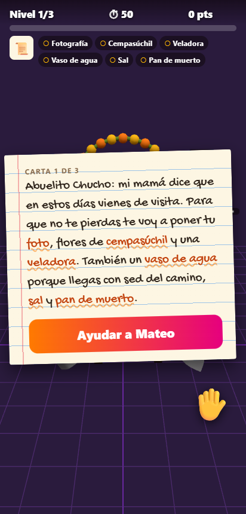
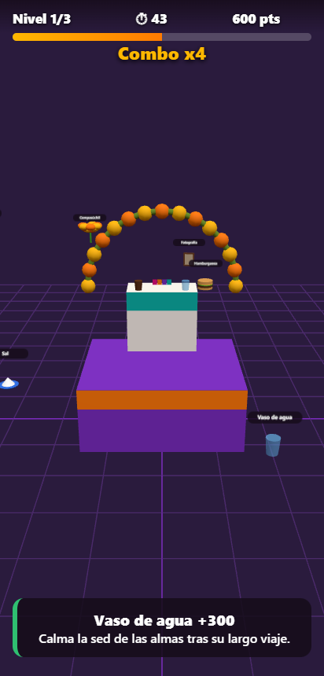
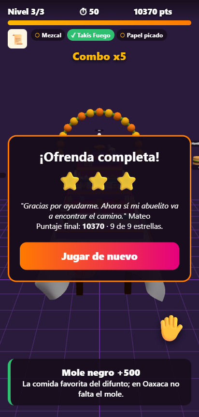

# Altar de Muertos XR

Videojuego de **realidad aumentada sin marcadores**. El teléfono detecta tu piso o tu mesa, colocas ahí un **altar de muertos oaxaqueño** a escala real y las ofrendas flotan a su alrededor. Tócalas para subirlas al altar, pero cuidado con los intrusos que no van en una ofrenda.

> Actividad 4 · Realidad Virtual y Aumentada · 2026

| Inicio | Partida | Nivel completado |
|---|---|---|
|  |  |  |

## Propuesta

El Día de Muertos en Oaxaca se vive armando la ofrenda en casa. El juego lleva esa tradición a tu propio espacio y enseña qué lleva un altar y por qué: cada ofrenda correcta muestra su significado.

## Cómo se juega

1. **Escanea:** aparece la indicación "mueve el teléfono despacio" mientras WebXR busca superficies. Cuando encuentra una, aparece un círculo sobre el piso o la mesa.
2. **Coloca:** toca para anclar el altar: una mesa con mantel y papel picado, y encima los escalones. Se orienta solo hacia ti.
3. **Arma la ofrenda:** alrededor del altar orbitan ofrendas con su nombre.
   - **Correctas:** cempasúchil, veladora, pan de muerto, calavera de azúcar, agua, sal, copal, fotografía, papel picado, mole negro y chocolate de agua. Al tocarlas vuelan a su lugar en el altar.
   - **Intrusos:** calabaza de Halloween, celular, pizza, balón y hamburguesa. Restan puntos.
4. **Completa el altar** antes de que se acabe el tiempo.

### Niveles

| Nivel | Altar | Significado | Meta | Tiempo |
|---|---|---|---|---|
| 1 | 2 pisos | El cielo y la tierra | 6 ofrendas | 50 s |
| 2 | 3 pisos | Cielo, tierra e inframundo | 8 ofrendas | 55 s |
| 3 | 7 pisos | Los siete pasos hacia el descanso eterno | 10 ofrendas | 60 s |

En cada nivel aparecen más intrusos. Cada partida dura de 2 a 3 minutos, para cuidar la batería y la temperatura del teléfono.

## Gamificación y retroalimentación

| Elemento | Detalle |
|---|---|
| Puntos | +100 por acierto con combo hasta x5, −50 por intruso, +10 por cada segundo que sobre |
| Progresión | 3 niveles con altares cada vez más altos y más intrusos |
| Tiempo | Cuenta regresiva; parpadea en rojo en los últimos 10 s |
| Recompensas | 1 a 3 ⭐ por nivel según la rapidez (máximo 9) y el altar que se llena |
| Visual | Chispas de colores, la ofrenda vuela en arco hasta su piso, destello rojo con los intrusos, barra de progreso y combo |
| Sonido | Acierto, error, ofrenda colocada, nivel ganado y nivel perdido |
| Háptica | Vibración corta al acertar, doble al fallar y larga al perder |
| Música | *Dios nunca muere*, el vals de Macedonio Alcalá que se considera el himno de Oaxaca, en guitarra y en bucle |

## Comprensión del entorno

- WebXR `immersive-ar` con **hit-test** contra los planos que detecta ARCore.
- **Anclas** (`anchors`, opcional): el altar queda fijo aunque el sistema reajuste el mapa. Si el dispositivo no las soporta, usa la pose del hit-test.
- **DOM overlay:** HUD y paneles en HTML encima de la cámara. Los botones usan `beforexrselect` para que no cuenten como toque en la escena.
- Toques en pantalla: el rayo del input transitorio de WebXR atraviesa el punto tocado. Cada ofrenda tiene una zona de toque invisible más grande que el objeto para facilitar el tiro en el teléfono.

## Herramientas

- WebXR Device API (hit-test, anchors, dom-overlay).
- three.js 0.160.
- Web Audio API para los efectos, `<audio>` para la música y Vibration API.
- Modelos 3D de Sketchfab con licencia CC BY 4.0 (mesa del altar, pan de muerto y veladoras), adaptados en Blender 5.2 con `modelos/preparar_modelos.py`: a la mesa se le quitan las ofrendas que traía, se lleva a escala real (62 cm de ancho, 47 cm de alto) y se reducen mallas y texturas.
- Las demás ofrendas son procedurales con primitivas de three.js. Cualquier ofrenda se puede sustituir dejando un GLB con su `id` en `assets/models/` (por ejemplo `copal.glb`).

Para regenerar los modelos, con los GLB originales descargados de Sketchfab en una carpeta:

```bash
blender --background --python modelos/preparar_modelos.py -- <carpeta>
```

## Requisitos

- **Android con Chrome** y Servicios de Google Play para RA (ARCore). WebXR AR **no funciona en iPhone**. En navegadores sin soporte se muestra un aviso y un enlace al modo demo.
- HTTPS (o `localhost`).
- Superficie con textura y buena luz. Evita mesas blancas lisas o brillantes.

## Instalación y uso

```bash
git clone <url-del-repo> && cd 04-altar-de-muertos-xr
npx serve .
```

- Publica la carpeta en **Vercel** o **Cloudflare Pages** (estático, sin build) y abre la URL en Chrome para Android.
- `index.html?demo`: el juego sin RA, con el altar en una cuadrícula y toques con el mouse.
- Prueba de reglas y puntaje: `node js/juego.test.mjs`.

## Estructura

```
index.html         overlay: inicio, HUD, mensajes y paneles
css/styles.css
js/main.js         sesión WebXR, hit-test, anclas, toques, bucle y flujo de niveles
js/juego.js        niveles, puntaje, combo, tiempo y estrellas (sin three.js)
js/escena.js       altar escalonado, catálogo de ofrendas, retícula
js/audio.js        música y efectos sintetizados
assets/models/     mesa.glb, pan.glb, veladora.glb
assets/audio/      musica.mp3
modelos/           script de Blender que prepara los modelos
```

## Créditos y licencias

| Recurso | Autor / fuente | Licencia |
|---|---|---|
| Código, diseño del juego y modelos procedurales | Carlos Antonio Gómez Morales | MIT (ver `LICENSE`) |
| Efectos de sonido | Sintetizados en código, autoría propia | MIT |
| Música: *Dios nunca muere* (guitarra) | Composición de Macedonio Alcalá (1868), dominio público; intérprete de la grabación: *por completar* | *por completar* |
| [Altar de Día de Muertos](https://sketchfab.com/3d-models/altar-de-dia-de-muertos-4feeb88e7948441c9d9034e32af2e2be) (solo mesa, mantel y papel picado) | [AORV](https://sketchfab.com/aorv) | CC BY 4.0 |
| [Pan de muerto](https://sketchfab.com/3d-models/pan-de-muerto-fcd63f39aa3a45fc98e7e4ef7193a929) | [gatoperdido](https://sketchfab.com/gatoperdido) | CC BY 4.0 |
| [Candles Asset Pack](https://sketchfab.com/3d-models/candles-asset-pack-56a68205dae649a388c6e3ba04145a9e) | [Em Marshall](https://sketchfab.com/emarshall) | CC BY 4.0 |
| three.js | three.js authors | MIT |

El significado de cada ofrenda se basa en la tradición oaxaqueña del Día de Muertos.
